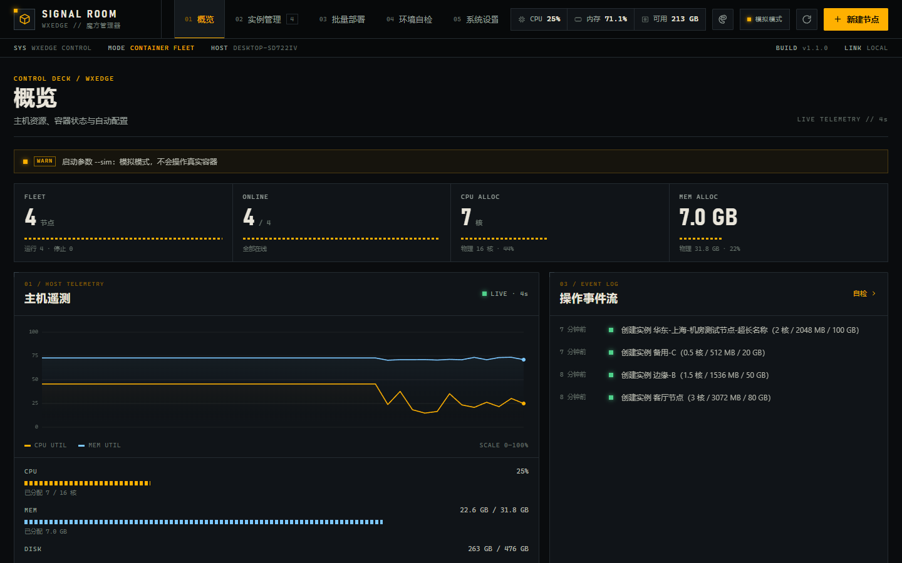
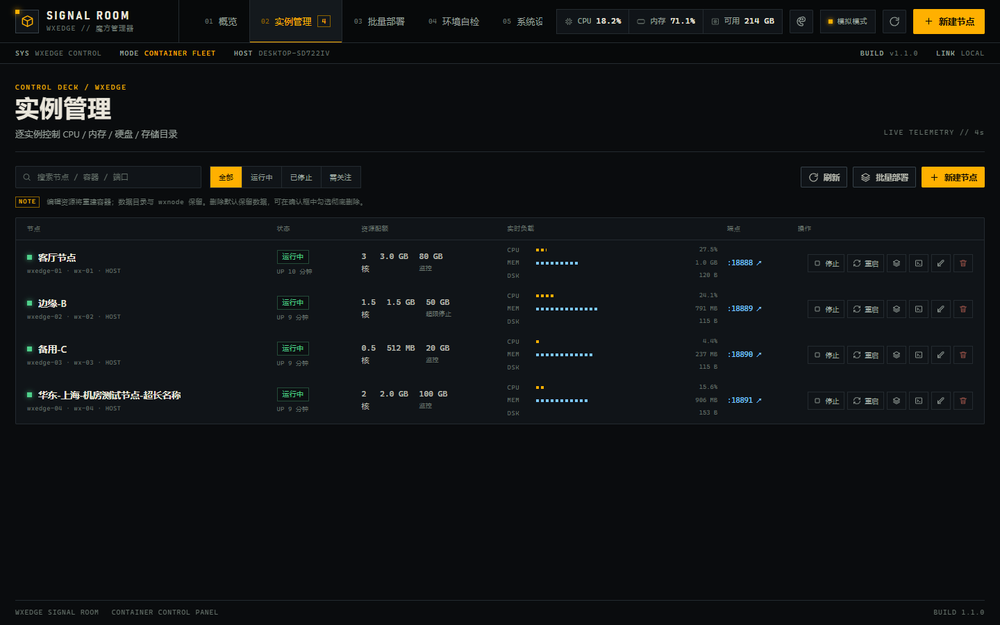

# WXEdge 魔方管理器

> 面向 Ubuntu 的 **网心云「容器魔方」多实例管理面板**：用一套 WebUI 创建、启动、停止、编辑、监控多个官方 `wxedge` 容器，逐实例分配 CPU、内存、硬盘与安装位置，并内置自动配置、环境自检和故障自愈。

仓库：https://github.com/wangmou1406/wxedge-manager



## 界面设计（SIGNAL ROOM）

2026 重设计：从通用的深色 SaaS 仪表盘改为「机房信号面板」——顶部指挥栏替代侧边栏，实例改为**常规高密度表格**（状态灯 / 端口 / 规格 / 分段电平表 / 操作），不再使用机架造型，数字统一使用等宽字体，琥珀色只用于操作与实时指示。

- **方向**：电信机房仪表盘；受众为常驻命令行的单机运维；operate 模式（高密度、快速扫读）。
- **字体**：展示字 Bahnschrift Condensed，等宽数据 Cascadia Mono / Consolas；正文系统无衬线中文栈。
- **色板**：石墨黑 `#0a0c0e` / 面板 `#101418` / 暖白 `#e9e5da` / 琥珀 `#ffb000` / 状态绿 `#4fd18b` / 告警红 `#ff5c47` / 遥测蓝 `#7cc7ff`。
- **记忆点**：分段 LED 电平表 + 行内状态灯；表格行高 66px，扫一眼可读完整机群。
- **状态覆盖**：hover / focus-visible / disabled / 空状态（BOOT SEQUENCE）/ 加载骨架 / 错误提示；提供 `prefers-reduced-motion` 降级。
- **响应式**：>1100px 六列节点表格；≤1100px 折叠为状态/操作双列；≤760px 单列堆叠，按钮与触控目标 ≥40px。
- **主题**：右上角调色板可在 5 套主题之间切换（琥珀机房 / 荧光绿屏 / 冰蓝遥测 / 警戒红 / 纸感机柜），选择保存在浏览器本地，图表与仪表同步换色。

## 功能

- **实例管理**：创建 / 启动 / 停止 / 重启 / 重建 / 删除，状态与运行时长实时展示。
- **逐实例资源分配**：`--cpus`、`--cpuset-cpus`、`--memory`、`--memory-swap`、独立端口（`LISTEN_ADDR`）。
- **硬盘与安装位置**：每实例独立存储目录（挂载 `/storage`）、独立容器安装目录（挂载 `/var/lib/containerd`）。
- **存储目录自动探测**：Linux 下自动读取 `/proc/mounts` 挂载点与 `/mnt`、`/media`、`/data`、`/srv`、`/opt`、`/home`、`/var/lib` 等常见目录，创建 / 批量部署 / 设置页的路径输入框弹出锚定下拉，列出路径、来源（挂载点/常用目录/当前设置）、可写状态与剩余空间；Windows 开发环境对应读取盘符。同一文件系统内的目录会显示相同剩余空间。
- **每实例存储上限**：两种模式 —— **独立 ext4 磁盘镜像（loop）** 由内核文件系统硬性限容，写满即 `No space left on device`；**目录模式** 由管理器统计用量，可设置「超限自动停止实例」策略，卡片实时显示已用 / 上限进度条。
- **批量自动配置**：按主机 CPU / 内存 / 数据盘自动计算配额，自动分配端口、命名、存储目录；支持「均衡 / 性能优先 / 省资源」三种策略，先预览后一键创建。可选项：固定每个实例的 CPU 核心数、内存 MB、硬盘 GB，以及限定端口起始与结束范围；留空仍自动分配。分配方案里的端口可直接点击，在新标签页打开对应的激活地址。实例数量不设人为上限，实际数量由主机资源与可用端口决定（方案预览会给出容量告警）。
- **环境自检**：Docker 守护进程、镜像、存储写入、root 权限、loop 支持、访问令牌、磁盘空间一次性体检。
- **自动修复与自愈**：容器退出或丢失时按原配置自动拉起 / 重建（可按实例开关），默认重启策略 `always`。
- **镜像维护**：一键拉取 / 更新官方镜像；可选 watchtower 自动更新（需 Docker）。
- **可视化主机监控**：CPU / 内存 / 数据盘曲线与分配率，操作动态时间线。
- **访问安全与端口**：可选访问令牌保护全部 API 与页面；面板监听地址 / 端口可在「系统设置」中修改，保存后一键重启并自动跳转到新端口。
- **零第三方依赖**：仅 Python 3.8+ 标准库 + Docker CLI；后端/前端均无 npm、无 pip 依赖。



## 系统要求

- Ubuntu 20.04+ / Debian 11+（其他 Linux 亦可，WSL2 支持模拟模式）
- Python 3.8+（Ubuntu 自带）
- Docker Engine（真实容器所需；未安装时自动进入 **模拟模式** 供界面演示与测试）
- root 权限（创建 `--privileged` 容器、可选 loop 磁盘）

## 安装（Ubuntu / Debian）

一键安装：

```bash
curl -fsSL https://raw.githubusercontent.com/wangmou1406/wxedge-manager/main/install-online.sh | sudo bash
```

改端口：

```bash
curl -fsSL https://raw.githubusercontent.com/wangmou1406/wxedge-manager/main/install-online.sh | sudo bash -s -- --port 9000
```

安装器依次做这些事：

- 补齐 `curl`、`tar`、`ca-certificates`；
- 从 GitHub 下载源码；
- 安装 Python 3 和 Docker Engine（已有则跳过；加 `--skip-docker` 只装面板）；
- 把程序复制到 `/opt/wxedge-manager`，数据放 `/var/lib/wxedge-manager`；
- 写入面板监听地址和端口，注册并启动 `wxedge-manager` systemd 服务；
- 没有 systemd 的环境（WSL、容器）自动跳过服务，安装后运行 `sudo wxedge-manager`。

装完访问 `http://<服务器IP>:8080`。端口之后可以在 WebUI 的「系统设置 → 面板监听」里改，保存后自动重启。

`install.sh` 的参数都可以跟在 `--` 后面：

```bash
... | sudo bash -s -- --port 9000 --data-dir /data/wxedge --skip-docker
```

GitHub 下载慢时，用镜像的 tar.gz：

```bash
curl -fsSL https://raw.githubusercontent.com/wangmou1406/wxedge-manager/main/install-online.sh | sudo WXEDGE_SRC_URL="https://mirror.example/wxedge-main.tar.gz" bash
```

### 从源码安装

```bash
git clone https://github.com/wangmou1406/wxedge-manager.git
cd wxedge-manager
sudo ./install.sh
```

### 更新

重新执行一键安装命令，会覆盖程序文件；`/var/lib/wxedge-manager` 里的配置和实例数据不动。
### 手动运行

```bash
python3 app/main.py --host 0.0.0.0 --port 8080 --data-dir ./data
# 无 Docker 演示 / 测试：
python3 app/main.py --port 8080 --data-dir ./data --sim
```

### Docker 部署（可选）

```bash
docker compose up -d --build
```

> 管理器容器必须挂载 `/var/run/docker.sock`，且实例数据目录需以宿主机相同路径挂载（见 `docker-compose.yml` 注释）。

## 使用流程

1. **环境自检**：进入「环境自检」→「开始自检」，确认 Docker 可用、镜像已就绪、存储可写。
2. **新建实例** 或 **批量部署**：
   - 单个实例：填写 CPU / 内存 / 硬盘 / 存储目录 / 端口，右侧实时预览 `docker run` 命令；
   - 批量部署：选择策略与数量 → 生成分配方案 → 检查无误后一键创建。
3. 创建完成后，在实例卡片点击 **激活入口**（`http://主机:监听端口`），用 **网心云 App 扫码** 绑定设备。
4. 日常运维：卡片的启动 / 停止 / 重启 / 重建 / 日志 / 编辑；编辑资源配置会重建容器，**数据目录与 `wxnode` 保留**。
5. 删除实例默认 **保留数据目录**；确认勾选「同时彻底删除数据目录」才会删除 `wxnode`。
6. 存储限额：实例卡片显示「存储」用量条与模式标签（监控 / 硬限制 / 超限停止）。独立磁盘模式创建即按设定容量建卷；目录模式在健康检查中统计用量，选择「超限自动停止」后会在超过上限时停止实例并记录动态。

## 实现原理

管理器调用 Docker CLI，生成与官方文档一致的容器参数：

```
docker run -d --name wxedge-xx --restart always --privileged --net host \
  --tmpfs /run --tmpfs /tmp \
  -v <数据目录>/storage:/storage:rw \
  -v <数据目录>/containerd:/var/lib/containerd \
  -e LISTEN_ADDR=:<端口> \
  --cpus <CPU> --memory <内存>m --memory-swap <内存>m \
  --label wxedge.manager=1 --label wxedge.instance=<id> \
  images-cluster.xycloud.com/wxedge/wxedge:latest
```

- 多实例共用 host 网络时，通过不同的 `LISTEN_ADDR` 端口区分激活页面（官方文档提供的多开参数方式）。
- 所有实例配置持久化在 `<data-dir>/state.json`；模拟模式运行状态保存在 `sim-runtime.json`。
- 后台线程按设定间隔检查容器，异常时自动拉起（仅当实例 `desired_state=running` 且启用自愈）。

## 存储限额与面板端口

### 存储限额

- **独立磁盘镜像（硬限制）**：为实例创建 `<数据目录>/storage.img`，`mkfs.ext4` 后挂载到 `<数据目录>/storage`，容器看到的就是这个固定大小的文件系统。写入超过 `disk_gb` 会立即返回 `No space left on device`，不依赖监控线程。
  - 需要 Linux + root + `/dev/loop-control`（Ubuntu 默认满足；容器内部署需 `privileged`）。
  - 修改容量时自动扩容镜像并 `resize2fs`；删除实例会卸载并清理镜像。
- **目录模式（监控配额）**：按 `disk_gb` 统计数据目录实际占用，在界面上显示用量百分比。可设置「超限自动停止实例」；达到上限后由健康检查停止容器，并把实例标记为已停止，操作动态中记录超限详情。
- 批量部署同样支持默认磁盘模式与默认超限策略。

### 面板端口

- 修改位置：「系统设置 → 面板监听地址 / 端口 → 保存并重启」。
- 保存后管理器在当前进程内 `exec` 重启，重新读取状态文件中的监听配置；页面会自动跳转到新地址。
- 端口持久化在 `<data-dir>/state.json`，重启服务器 / systemd 服务后仍然生效；`install.sh --port` 只作为安装时的初始值。

## API 概览

| 方法 | 路径 | 说明 |
| --- | --- | --- |
| GET | `/api/health` | 健康检查（无需令牌） |
| GET | `/api/overview` | 主机、设置、实例、动态汇总 |
| GET/POST | `/api/instances` | 列表 / 创建实例 |
| GET/PUT/DELETE | `/api/instances/{id}` | 详情 / 更新（重建）/ 删除（`?purge=1` 删数据） |
| POST | `/api/instances/{id}/action` | `start` / `stop` / `restart` / `recreate` / `enable` / `disable` |
| GET | `/api/instances/{id}/logs?tail=200` | 容器日志 |
| POST | `/api/plan` | 批量自动配置预览 |
| POST | `/api/batch` | 批量创建 |
| POST | `/api/preview` | 单实例 docker 命令预览 |
| GET/PUT | `/api/settings` | 读取 / 更新系统设置 |
| GET | `/api/self-check` | 环境自检 |
| POST | `/api/pull-image` / GET `/api/jobs/{id}` | 拉取镜像任务 |
| POST | `/api/system/restart` | 重启面板（应用已保存的监听地址 / 端口） |

携带令牌：请求头 `X-Auth-Token: <token>`，或 URL 参数 `?token=`。

## 安全建议

1. 面板默认可被局域网访问；**公网暴露前务必设置访问令牌**（系统设置 → 访问令牌）。
2. 建议放在 Nginx / Caddy 反向代理后并启用 HTTPS，只允许可信来源。
3. 管理器需要 root 权限（Docker privileged + loop 设备），请在专用主机运行。
4. 实例使用官方镜像；本工具**不修改任何设备指纹、不伪造硬件信息、不绕过激活流程**。

## 关于网心云多开的说明

- 官方文档确认可以通过 `LISTEN_ADDR` 运行多个容器，但同时明确写有 **「不建议多开容器」**。
- 每个容器仍需使用网心云 App 扫码激活并绑定自己的 `wxnode`；账号数量、收益与风控规则以官方为准，请自行评估合规性与收益风险。
- 本工具只是 Docker 编排 + 资源限制的管理面板，不会伪造资源或规避平台检测。

## 测试

```bash
# 后端 API 集成测试（模拟后端，无需 Docker）
python3 -m unittest discover -s tests -v

# 前端语法检查
node --check app/static/app.js
```

GUI 黑盒测试报告与截图见 `gui-test-screenshots/` 与最终交付说明。本仓库在 Windows + WSL2 Ubuntu 24.04 上完成安装与浏览器实测。

## 目录结构

```
wxedge-manager/
├── app/
│   ├── main.py            # 标准库 HTTP 服务 + REST API + 静态资源
│   ├── manager.py         # 实例生命周期、自动配置、自检、自愈
│   ├── storage.py         # loop ext4 独立卷与配额/用量工具
│   ├── docker_backend.py  # docker CLI 封装（真实容器）
│   ├── sim_backend.py     # 模拟后端（无 Docker 演示 / 测试）
│   ├── hostinfo.py        # CPU / 内存 / 磁盘 / 系统信息
│   ├── store.py           # JSON 持久化 + 操作动态
│   └── static/            # index.html / style.css / app.js / favicon.svg
├── tests/test_api.py      # 7 组 API 集成测试
├── install.sh / uninstall.sh
├── systemd/wxedge-manager.service
├── Dockerfile / docker-compose.yml
└── README.md
```

## 常见问题

**Q：页面显示「模拟模式」？**
A：没有检测到可用的 Docker 守护进程。执行 `sudo systemctl enable --now docker`，或确认当前用户能运行 `docker info`。

**Q：创建容器失败 `permission denied`？**
A：管理器需要 root 才能创建 privileged 容器；请用 systemd 服务运行或 `sudo python3 app/main.py`。

**Q：多个实例端口冲突？**
A：host 网络模式下每个实例的 `LISTEN_ADDR` 必须不同；使用批量部署会自动分配空闲端口。

**Q：独立磁盘镜像不可用？**
A：需要 Linux + root + `/dev/loop-control`；容器内运行管理器时需 `privileged`。受限环境请使用默认「目录挂载」模式。

**Q：数据会丢吗？**
A：所有实例数据保存在数据目录下，删除实例默认保留；`wxnode` 是设备唯一标识，换机/迁移时请备份。